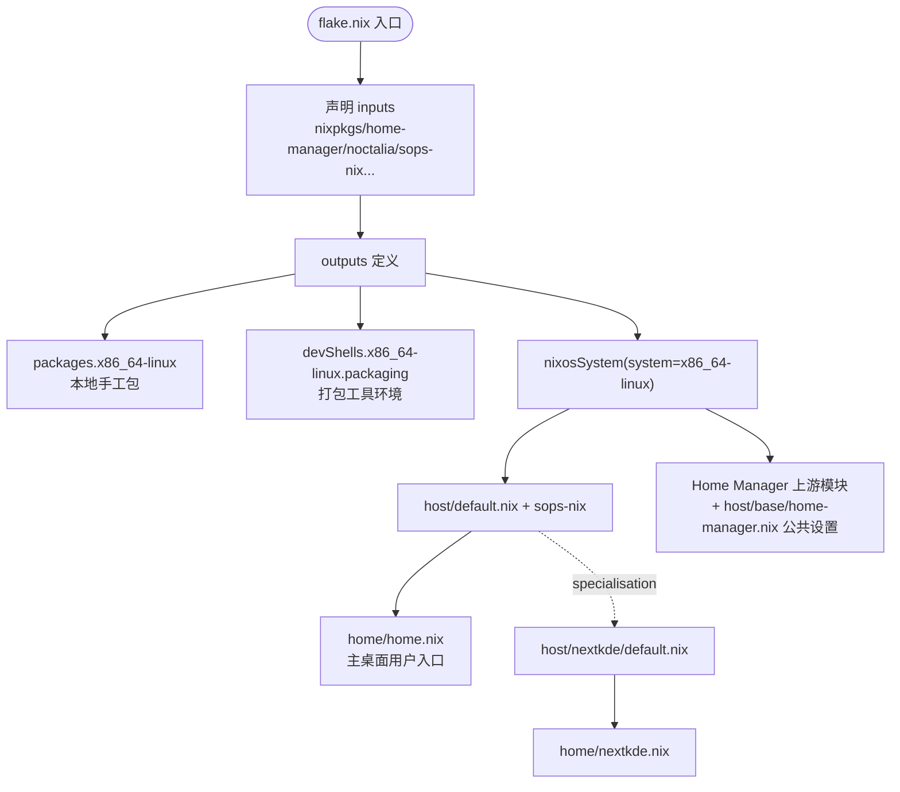
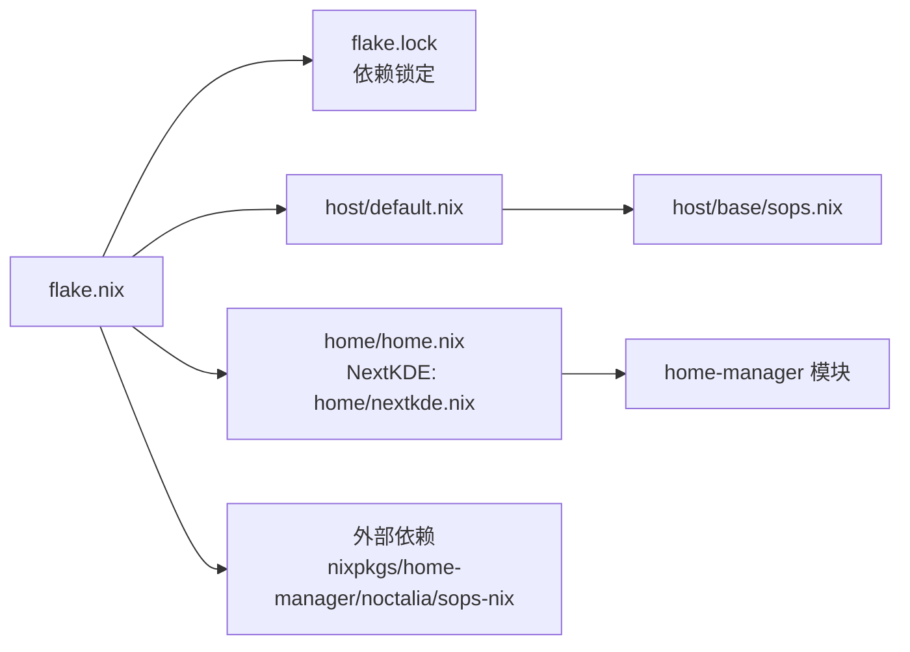
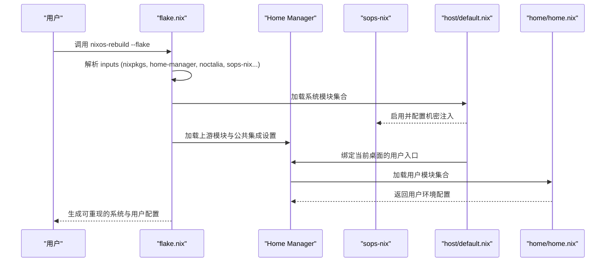

# Flake 配置管理

## 目录
1. [简介](#简介)
2. [inputs：外部依赖](#inputs外部依赖)
3. [outputs：系统装配](#outputs系统装配)
4. [统一检查入口](#统一检查入口)
5. [依赖锁定与跟随](#依赖锁定与跟随)
6. [装配流程](#装配流程)
7. [最佳实践](#最佳实践)
8. [相关链接](#相关链接)

## 简介

`flake.nix` 是整个仓库的统一入口，采用「系统级配置（`host`）+ 用户级配置（`home`）」的分层组织方式。它集中声明外部依赖，并在 `outputs` 的 `nixosConfigurations` 中定义具体主机配置；`flake.lock` 锁定所有依赖版本，确保跨时间、跨机器的可重现构建。

## inputs：外部依赖

`flake.nix` 的 `inputs` 部分声明了系统所需的全部外部来源：

- `nixpkgs`：冻结在上一版配置验证过的固定提交（当前 `f9a75f4`，2026-11-05），作为系统、Home Manager 与默认包集来源；推进时只改这里的 rev。
- `nixpkgs-latest`：跟踪 `nixos-unstable`，只用于个别包单独取新，不参与系统装配。
- `nixpkgs-release`：跟踪官方 `nixos-26.05` 稳定频道，作为个别包的兜底来源。
- `scrolloverview-src`、`hypr-dynamic-cursors-src`：跟踪两个 Hyprland 插件的上游 `main`，只获取源码（`flake = false`），不引入上游各自的 Hyprland 或工具链；本地包定义使用系统 Hyprland 构建。
- `nextkde`：固定上游提交 `3fa1d7006869bbd3404a05d362c6e6028e0fe3da`，跟随根 `nixpkgs`，提供 KOS 模块和包。
- `strata-nixpkgs`：临时固定 fork 提交，只消费其中的 Strata，包集与系统隔离；官方频道可用后移除。
- `wetypex`：WeTypeX 上游 flake，提交由 `flake.lock` 固定，依赖跟随根 `nixpkgs`；`host/base/input-method.nix` 直接使用其包参数设置个人功能和主题选项。
- `home-manager`：用户环境管理框架。
- `noctalia`：桌面壳模块；主桌面登录器由本地 `host/de/greeter.nix` 配置 greetd/tuigreet。
- `sops-nix`：机密管理与注入。
- `nix-flatpak`：Flatpak 集成。
- `codex-desktop-linux`：Codex Desktop 的桌面发行来源。

多数输入通过 `inputs.nixpkgs.follows = "nixpkgs"` 复用冻结的稳定源，保持 Home Manager、桌面模块与系统包集版本一致；`nixpkgs-latest` 和 `nixpkgs-release` 只通过 `specialArgs` 暴露为 `pkgsLatest`/`pkgsRelease`，按包引用。

## outputs：系统装配

`outputs` 同时提供本地包、打包开发环境和名为 `MechRevo-NixOS` 的系统配置：

- `packages.x86_64-linux` 暴露全部 `local-deriv/` 手工包、WeTypeX 上游默认包别名、NextKDE 和临时 Strata 消费入口，可用 `nix build path:.#<pname>` 独立构建。NextKDE 分为 `nextkde-shell`（含天气，保留 `nextkde` 兼容别名）、`nextkde-apps`（日历/待办/计算器）、`nextkde-spatial-models`（固定空间壁纸模型）、`nextkde-platform-whitesur`（KOS 的 WhiteSur 明暗配色修正）和 `nextkde-qdbus6`（Qt 命令名兼容入口），只由对应 specialisation 消费。
- `devShells.x86_64-linux.packaging` 提供 `$nix-packaging` 流程使用的预取、更新、格式化和 ELF 诊断工具。
- `checks.x86_64-linux` 从 `checks/default.nix` 加载测试与仓库结构检查；`formatter.x86_64-linux` 使用锁定包集的 `nixfmt`。
- `nixosConfigurations.MechRevo-NixOS` 使用 `nixpkgs.lib.nixosSystem` 装配系统。

- `system` 指定为 `x86_64-linux`。
- `specialArgs` 将 `inputs`、`materialGnomeTheme`、`pkgsLatest`、`pkgsRelease` 传入系统模块。
- `modules` 列表组合本地 `host/default.nix`、sops-nix、Home Manager 与公共设置 `host/base/home-manager.nix`；NextKDE 入口也复用同一份公共设置。上游模块保持原来的导入层级，避免改变列表合并顺序。
- Home Manager 公共设置集中在 `host/base/home-manager.nix`：开启 `useGlobalPkgs`/`useUserPackages`，传递共享参数 `inputs` 与 `materialGnomeTheme`。不设置全局备份后缀；与未受管理的同名文件发生冲突时会阻止激活，显式设置 `force = true` 的文件会直接覆盖，且不生成备份。
- `host/default.nix` 选择 `home/home.nix`，`host/nextkde/default.nix` 选择 `home/nextkde.nix`，保持两个桌面用户入口独立。



各子模块的组合方式：`host/default.nix` 导入共享的 `host/base/default.nix` 与主桌面的 session/greeter；`host/base/default.nix` 再集中导入硬件与系统服务。Home Manager 集成由系统装配入口显式导入。`home/base.nix` 导入两个变体共享的环境、开发、生产力和娱乐模块，并启用 nix-flatpak 用户模块；主题与桌面模块由各自 HM 入口组合。

## 统一检查入口

```bash
nix flake check path:.
nixos-rebuild dry-build --flake path:.
# 格式化检查只针对本次修改的文件，按需追加路径：
nix fmt -- --check flake.nix
```

`nix flake check` 会求值 flake，并构建 `checks` 中的检查；`--no-build` 不运行测试，见 [Nix 命令说明](https://nix.dev/manual/nix/2.34/command-ref/new-cli/nix3-flake-check)。

| 检查 | 覆盖范围 |
| --- | --- |
| `mihomo-config-sync` | 已有的 Python 同步器测试，不访问真实订阅或运行中的服务 |
| `hyprland-policies` | `tests/` 目录中的 Lua 事件 mock，不启动或连接 Hyprland |
| `hyprland-scrolloverview`、`hyprland-dynamic-cursors` | 实际编译两个插件，检查锁定源码与系统 Hyprland 的编译兼容性；不加载到桌面 |
| `repository-structure` | Wiki 文档登记、来源路径存在性、home/host Nix 模块覆盖，以及重复 YAML key |

单独运行一项：`nix build path:.#checks.x86_64-linux.repository-structure --no-link -L`。

`scripts/check-repo-structure.py` 只读 `wiki/_sources.yaml` 这一份映射。目录来源覆盖其下 Nix 模块；新增文件未进入 Git 时使用 `path:.`，无需为检查暂存。检查源排除 Git 元数据、本地 `memory/`、工具状态和构建产物。

需要额外核对本地记忆卡片时，复用检查所用的 Python 与 PyYAML 环境：

```bash
nix develop path:.#checks.x86_64-linux.repository-structure -c \
  python3 scripts/check-repo-structure.py --memory-root /home/lishangshui/myNixOSConfig/memory
```

未显式指定路径且当前仓库没有 `memory/cards/` 时，会明确提示跳过；显式指定后，目录或卡片缺失都报错。纯 flake 检查不依赖本机记忆。上述测试与 dry-build 均不应用配置，Lua mock 不证明桌面运行行为。

## 依赖锁定与跟随

- **依赖锁定**：`flake.lock` 记录所有直接与间接依赖的版本、提交哈希与来源，确保构建可重现。
- **依赖跟随**：`home-manager`、`sops-nix` 等通过 `follows` 复用根 `nixpkgs`（stable）；桌面 shell（`noctalia`、`caelestia`、`shell-switcher`）与 AI 工具（`codex-desktop-linux`）跟随 `nixpkgs-latest`；compositor、内核和系统服务留在 stable。
- **投稿包例外**：`strata-nixpkgs` 保留已验证 revision 的包集，只取 `strata`；不替换系统包集、不配置 `follows` 或本地 overlay。
- **升级路径**：`nix flake update nixpkgs-latest nixpkgs-release` 单独推进最新源；推进整机时改 `nixpkgs` 的固定 rev 并 `nix flake update nixpkgs`，配合 rebuild 验证，失败可回退上一个 rev。
- **Hyprland 插件**：可用 `nix flake update scrolloverview-src hypr-dynamic-cursors-src` 单独更新源码，无需手改 `rev` 或哈希。更新 nixpkgs 或插件后都要实际构建两个插件；最新提交并不保证兼容性，具体步骤见 [Hyprland 插件更新](../desktop/hyprland.md#光标)。



## 装配流程

一次 `nixos-rebuild` 从 Flake 到用户环境的装配顺序：



## 最佳实践

- 始终提交 `flake.lock` 锁定依赖，避免版本漂移。
- 通过 `follows` 复用 `nixpkgs`，减少版本碎片化。
- 手工包通过 `$nix-packaging` 维护，并用 flake package output 独立构建后再进入系统 dry-build。
- 打包辅助工具从 `nix develop .#packaging` 获取，不常驻安装到用户环境。
- 系统级变更用 `sudo nixos-rebuild switch --flake .`；用户级变更由 rebuild 自动处理。
- 缓存加速：在 `host/base/nix.nix` 配置多个 substituters（官方 + 镜像源），并启用 `nix-command`、`flakes` 实验特性；`nh` 自动清理旧代际以维持磁盘空间。
- Zotero 的 ESR 140 运行时采用确切版本例外放行；升级引擎后移除，见 [办公软件套件](../productivity/office.md#zotero-文献管理)。

## 相关链接

- [系统架构总览](index.md)
- [主机系统架构与启动流程](host.md)
- [项目概述](../overview.md)
- 为何锁定 unstable 频道：[../../memory/cards/flake-unstable-strategy.md](../../memory/cards/flake-unstable-strategy.md)
