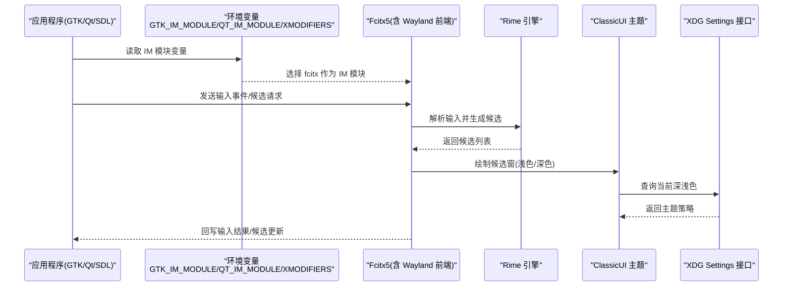
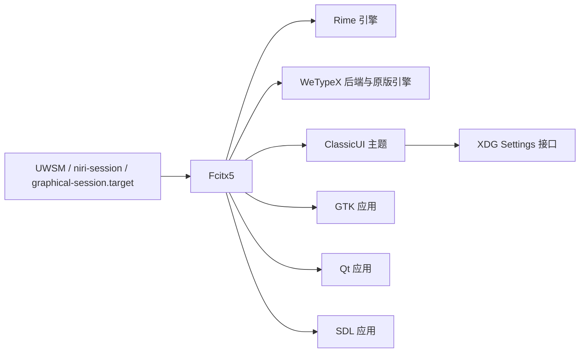

# Fcitx5 输入法框架

本文说明本仓库如何在 NixOS + Home Manager 下启用并集成 Fcitx5：引擎与主题管理、中文输入方案、Wayland 主桌面集成、候选窗定制与常见排障。核心 + 变体差异集中在系统级 `host/base/desktop.nix`；主桌面（Hyprland/niri）使用 ClassicUI，GNOME 走 kimpanel。

## 目录
1. [快速上手](#快速上手)
2. [系统级配置要点](#系统级配置要点)
3. [引擎与中文输入方案](#引擎与中文输入方案)
4. [主题与候选窗定制](#主题与候选窗定制)
5. [桌面集成与崩溃自恢复](#桌面集成与崩溃自恢复)
6. [架构总览](#架构总览)
7. [故障排查](#故障排查)
8. [配置速查](#配置速查)
9. [相关链接](#相关链接)

## 快速上手
Fcitx5 在系统构建后即随会话启动，无需额外操作：

- 应用通过环境变量自动接入 fcitx（GTK/Qt/SDL 统一）。
- `i18n.inputMethod` 安装 Fcitx5 及 addons，并提供 XDG autostart desktop entry。
- UWSM 或 niri-session 激活图形会话后，`systemd-xdg-autostart-generator` 将其转换为用户单元 `app-org.fcitx.Fcitx5@autostart.service`。
- 使用桌面环境快捷键（如 `Super+Space`）在中英文/输入法间切换。
- 首次使用建议运行 `fcitx5-configtool` 检查方案与顺序。

查看进程和日志：

```bash
systemctl --user status app-org.fcitx.Fcitx5@autostart.service
journalctl --user -u app-org.fcitx.Fcitx5@autostart.service
```

## 系统级配置要点
系统层在 `host/base/desktop.nix` 中完成以下工作：

- Host 层提供跨桌面的 `QT_IM_MODULE=fcitx` 与 `XMODIFIERS=@im=fcitx`。
- 主桌面 HM 配置补充 `GTK_IM_MODULE=fcitx` 与 `SDL_IM_MODULE=fcitx`；GNOME 保持 GTK 原生 Wayland text-input-v3。
- 启用 `i18n.inputMethod`，`type = "fcitx5"`，并开启 `fcitx5.waylandFrontend = true` 以获得 Wayland 下更好的兼容性与性能。
- 安装插件与主题包（见下文）。
- `org.freedesktop.impl.portal.Settings` 由 Darkman 提供，供 Fcitx5 检测系统深浅色；GTK portal 继续提供文件选择等其他接口。

## 引擎与中文输入方案
中文能力由 Rime 和可选用的 WeTypeX 引擎提供，在 `host/base/desktop.nix` 的 `fcitx5.addons` 中声明：

- `fcitx5-rime`，并通过 `rimeDataPkgs` 注入 `rime-ice`、`rime-moegirl`、`rime-zhwiki` 数据包。
- `fcitx5-wetypex`：从固定版本源码构建的社区适配层，使用原版微信输入法引擎；初次使用还需完成下方初始化。
- 核心（两 DE）：`qt6Packages.fcitx5-chinese-addons`、`qt6Packages.fcitx5-configtool`、`kdePackages.fcitx5-qt`。
- 主桌面（`lib.optionals (!gnome)`）：`fcitx5-gtk` 桥 + 主题包（mellow/material/catppuccin）。

拼音、五笔、注音等具体方案由 Rime 数据与用户方案决定；上述数据包提供基础词库能力。如需新增或切换方案，在 Rime 数据层配置即可（不在本仓库内直接体现）。

### WeTypeX 首次使用

[WeTypeX](https://github.com/panxuc/fcitx5-wetypex) 是社区兼容层。本仓库固定 `2.2.3.657-13`，仅支持 Linux x86_64；本机 Ryzen 7 8845HS 满足要求。包定义为 `local-deriv/fcitx5-wetypex.nix`，独立构建入口为 `nix build path:.#fcitx5-wetypex`。

Nix 安装 Fcitx5 插件、设置界面和引擎宿主。腾讯原版引擎、词典和界面资源由用户在首次使用时获取，初始化器会校验固定版本与哈希。先由用户应用包含该包的 NixOS 配置，再在本人接受微信输入法上游许可后执行：

```bash
fcitx5-wetypex-setup --download --accept-upstream-license
fcitx5-wetypex-setup --check
```

已有原版 `WeType_2.2.3_657.zip` 时，可改用 `fcitx5-wetypex-setup --archive /完整路径/WeType_2.2.3_657.zip`。原版文件保留其自身许可，不受社区适配层的 MIT 许可覆盖。

初始化成功后，注销并重新进入桌面会话，使 Fcitx5 加载新插件；打开 `fcitx5-configtool`，取消“仅显示当前语言”筛选并添加 **WeTypeX**。原有 Rime 和候选窗主题保留，可随时切回。设置界面可从应用菜单打开，也可运行 `fcitx5-wetypex-settings`。

- 用户数据默认位于 `~/.local/share/fcitx5-wetypex/`；其中 `runtime/` 是原版资源，`state/` 是输入学习状态，`account/` 是配对数据。
- 偏好位于 `~/.config/fcitx5/wetypex.json`。离线输入不要求绑定账号；设备配对、云候选、同步等联网能力需要另外设置。
- `local-deriv/wetypex/nixos-runtime.patch` 将运行路径、动态库和证书路径适配到 Nix store，保留后端沙箱。未配对与单机模式使用独立网络命名空间。
- WeTypeX 自带的发行版更新器已关闭；适配层由 Nix 固定版本管理。它使用单独启用 WS/WSS 的 curl，不修改系统其他程序的 curl。

### WeTypeX 构建选项与首次默认值

在 `host/base/desktop.nix` 的 `pkgs.callPackage` 参数中设置以下选项；独立构建也可通过包的 `.override` 调整。

| 参数 | 默认值 | 效果 |
| --- | --- | --- |
| `enableAI` | `true` | 关闭时移除“AI 助手”快捷键设置、调用入口与查看器，并去掉 QtWebEngine 依赖。这里指 Ask AI，语音智能润色仍随语音功能管理。 |
| `enableVoice` | `true` | 关闭时隐藏语音页面与快捷键，阻断语音调用，不安装语音助手或采集脚本，也不再为语音添加 PipeWire/FFmpeg 命令工具。其他 Qt 功能仍可能间接引用相关资源。 |
| `enableLayerShell` | `true` | 控制 Wayland V 模式浮动工具栏的 LayerShell 支持。关闭后使用 Fcitx 原生候选菜单，V 模式的计算、常用语、剪贴板等功能保留。 |
| `defaultSettings` | `{ }` | 仅在 `wetypex.json` 不存在时创建首次偏好；已有文件不会被覆盖，也不会补写缺少的键。 |
| `enableWeTypeTheme` | `false` | 允许 WeTypeX 管理共用皮肤与字体，详见下方主题说明；当前继续使用桌面共用主题。 |

例如保留普通拼音和 V 模式、关闭 AI 与语音，并为新用户设置竖排候选：

```nix
enableAI = false;
enableVoice = false;
enableLayerShell = true;
defaultSettings = {
  page_size = 7;
  vertical = true;
};
```

这些功能开关在构建时生效。关闭后的界面入口会隐藏，旧 JSON 或 Fcitx 配置请求也不能重新启用相应功能；重新打开需修改 Nix、手动应用并重启 Fcitx5。设备同步与云候选继续使用上游行为，本包暂不提供设备同步开关。

`defaultSettings` 使用上游 JSON 键，传入的值必须可序列化为 JSON。初始化器在设置界面、插件或后端首次启动，以及引擎初始化完成后运行，以原子方式创建权限为 `0600` 的偏好文件；已有偏好保留，之后可在界面自由修改。更改 Nix 默认值不会重置已保存的个人设置，也不需要删除现有数据来应用功能开关。

- 包参数 `enableWeTypeTheme` 默认 `false`，本机也明确设为 `false`：沿用桌面的 Mellow/Matugen 候选窗主题，保存 WeTypeX 设置不会修改全局皮肤、字号或深浅模式。`preserve-desktop-theme.patch` 同时移除独立设置页和 Fcitx5 配置页中相应控件，保留候选序号、排列方向等输入法自身选项。
- 无需额外把此包加入 `home.packages`；Fcitx5 的 addons 聚合包已发布插件、工具和菜单项。

诊断命令 `fcitx5-wetypex-account network-info` 检查运行库功能，应报告 `utf8_json`、`ws`、`wss` 为 `true`；它不验证账号、网络服务或桌面输入效果。`setup --check` 检查原版资源与沙箱内的引擎初始化，实际候选窗、各应用输入和联网功能仍须在本人桌面会话中验证。

需要恢复 WeTypeX 自带的皮肤和字号控件时，在 `host/base/desktop.nix` 的包调用中开启：

```nix
(pkgs.callPackage ../../local-deriv/fcitx5-wetypex.nix {
  enableWeTypeTheme = true;
})
```

也可对已有包使用 `.override { enableWeTypeTheme = true; }`。更改后需手动应用配置并重启 Fcitx5。开启会恢复上游保存设置时改写共用 `classicui.conf` 的行为，Rime 等其他输入法也会使用同一皮肤；Darkman/Matugen 主题脚本仍会在刷新桌面主题时写回桌面配置。若希望稳定沿用桌面主题，保持此选项关闭。

## 主题与候选窗定制
主桌面（Hyprland/niri）的 ClassicUI 系统级配置由 `host/base/desktop.nix` 生成，运行时覆盖由 `theme-apply` 写入；GNOME 候选窗由 kimpanel 扩展绘制：

- 浅色主题 `Theme = "mellow-matugen"`，深色主题 `DarkTheme = "mellow-matugen-dark"`。
- `UseDarkTheme = "True"`：让服务端 ClassicUI 通过 XDG Settings 接口跟随 Darkman。
- GTK Wayland 客户端只读取 `Theme`，因此 `theme-apply` 会写入当前模式的完整用户配置；壁纸素材变化时重启 Fcitx5，单纯模式切换优先执行 `fcitx5-remote --check -r`，失败才回退到重启。
- [`fcitx5-mellow-themes-matugen`](https://github.com/Shangshui0302/fcitx5-mellow-themes-matugen) 保留 Mellow WeChat 的圆角布局；Matugen 将 `primary` 写入两套主题的高亮 SVG，将 `on_primary` 写入高亮文字配置。
- 动态主题覆盖位于 `~/.local/share/fcitx5/themes/mellow-matugen[-dark]/`。每份 `theme.conf` 都是完整主题，而不是颜色片段；fcitx5-gtk 只加载 XDG 搜索顺序中的第一份配置，不会与 Nix profile 的基础主题合并。
- 主桌面 HM 入口导入上游 `homeManagerModules.default`，并启用 `programs.fcitx5-matugen` 的 `themeSet = "both"`、`style = "blur"`；模块负责安装 `both-blur` 包并把两套 Matugen 模板链接到 `~/.config/matugen/templates/fcitx5-matugen-theme/`。
- Hyprland 的 `decoration.blur.input_methods = true` 允许主题请求 compositor 原生模糊；不支持该协议的会话会退化为普通主题。
- `"Vertical Candidate List" = "True"`：启用垂直候选列表，更适合长词条与高分屏。

安装的主题包：HM 模块提供的 `fcitx5-matugen-theme`（`both-blur`）、`fcitx5-mellow-themes`、`fcitx5-material-color`、`catppuccin-fcitx5`。

> 注意：HM 模块不写 `classicui.conf`；该文件仍由 `theme-apply` 原子生成，不要用图形配置工具手动覆盖。完整无 section header 的格式是必要的。

## 桌面集成与崩溃自恢复
- GTK/Qt/SDL 应用均通过环境变量接入 fcitx，无需逐应用配置。
- Wayland 下启用 `waylandFrontend` 减少 X11 桥接开销。
- 在 Hyprland 下，`home/de/hyprland.nix` 为 Fcitx5 提供 systemd user service 的崩溃自恢复策略（on-failure 重启），提升长期稳定性。
- `host/de/sessions.nix` 负责 GTK Portal 注册；`home/theme/base.nix` 只负责共享字体、光标和主题基础。

## 架构总览
下图以 Rime 为例展示应用、Fcitx5、引擎、主题与 Portal 的交互路径；选择 WeTypeX 时，引擎调用经过其独立后端进程。



依赖关系：



## 故障排查
- Rime 也变成微信皮肤：两者共用 Fcitx5 的 `classicui.conf`；旧包或 `enableWeTypeTheme = true` 的包会在保存 WeTypeX 外观设置时覆盖它。将该选项设为 `false`，手动应用配置并重启 Fcitx5；需要恢复已写入的皮肤时，在桌面终端运行 `theme-apply "$(darkman get)"`，然后重启 Fcitx5 使候选窗重新读取配置。无需重新下载引擎或清理 Rime 数据。
- rebuild 在 `theme.cpp` 出现 `Hunk FAILED`、`theme.h` 出现 `Reversed (or previously applied) patch`：检查是否还在添加旧 SVG 性能补丁 `d6552a5b52b4ff75cae3fb6dc949ef379171b2b9`。上游 5.1.23 已包含该修复，应直接使用 nixpkgs 原包，无需再次打补丁。
- 输入法不显示：检查 IM 环境变量（`GTK_IM_MODULE`、`QT_IM_MODULE`、`XMODIFIERS`）是否生效；确认 Fcitx5 进程在运行，若崩溃查看 systemd user service 是否自动重启。
- 候选窗位置异常/不可见：确认 `"Vertical Candidate List"` 为 `True`（键名含空格加引号、布尔值大写）；检查 XDG Portal 的 Settings 接口可用。
- GNOME Wayland 下候选窗飞远/不跟随光标：GNOME 只实现 `text-input-v3` 无全局坐标，必须靠 kimpanel 链路。检查 fcitx5 的 kimpanel addon 未被禁用（`~/.config/fcitx5/config` 的 `[Behavior/DisabledAddons]` 不应含 kimpanel）；`host/base/desktop.nix` 已声明 `fcitx5.settings.globalOptions.Behavior.EnabledAddons = "kimpanel"` 防复发，且 GNOME kimpanel 扩展需启用。kimpanel 启用后候选窗由扩展绘制，ClassicUI 主题（mellow-matugen）不再作用于 GNOME 会话——GNOME 下候选窗跟随 Shell 主题（本机 Material-Gnome）。
- 主题不跟随深浅色或重点色：执行 `darkman get` 确认状态，再运行 `theme-apply "$(darkman get)"`；确认 `~/.local/share/fcitx5/themes/mellow-matugen[-dark]/` 下的 `highlight.svg` 和 `theme.conf` 已更新。
- GTK 应用内候选窗退回白色方框：检查用户主题的 `theme.conf` 是否包含 `[Metadata]`、`[InputPanel/Background]`、`Image=panel.svg` 和 `[InputPanel/Highlight]`。只有颜色字段的稀疏文件会遮蔽完整 Nix 主题并触发 GTK 默认样式。
- 壁纸切换后候选窗仍是旧颜色：新壁纸会复制缓存中的两套 Fcitx 素材并重启服务；单纯深浅切换只 reload。检查 `systemctl --user status app-org.fcitx.Fcitx5@autostart.service`，必要时手动执行 `fcitx5-remote --check -r`。
- 候选窗样式/透明度问题：调整 ClassicUI 的 `Theme`/`DarkTheme`，并确保字体与 DPI 设置合理。

## 配置速查
- 环境变量：`GTK_IM_MODULE`/`QT_IM_MODULE`/`XMODIFIERS`/`SDL_IM_MODULE` 指向 fcitx。
- 插件与主题：`fcitx5-gtk`、`qt6Packages.fcitx5-chinese-addons`、HM 管理的 `both-blur` mellow-matugen、material/catppuccin 主题包。
- Rime 数据：`rime-ice`、`rime-moegirl`、`rime-zhwiki`。
- 候选窗：`"Vertical Candidate List" = "True"`。
- 深浅色联动：`darkman set dark|light` 后由 `theme-apply` 从壁纸缓存激活当前模式、更新 GTK 客户端配置、reload Fcitx5，并同步 Settings portal；新壁纸未命中缓存时才重渲染两套 Fcitx5 重点色并重启服务。

## 相关链接
- 桌面深色模式与主题联动：[darkmode.md](./darkmode.md)
- Hyprland 桌面配置：[hyprland.md](./hyprland.md)
- 决策：垂直候选窗与布尔值大写等踩坑 → [fcitx5-vertical-candidates](../../memory/cards/fcitx5-vertical-candidates.md)
- 决策：Portal / gtk 悬空软链问题 → [portal-gtk-dangling-symlink](../../memory/cards/portal-gtk-dangling-symlink.md)
- 决策：greetd/tuigreet TTY 与会话入口 → [greetd-tuigreet-tty](../../memory/cards/greetd-tuigreet-tty.md)
- 历史：TTY、UWSM 与 Fcitx5 autostart → [uwsm-kmscon-session-handoff](../../memory/cards/uwsm-kmscon-session-handoff.md)
- 决策：Darkman 状态、Matugen 渲染与 Stylix 基线 → [darkman-theme-authority](../../memory/cards/darkman-theme-authority.md)
