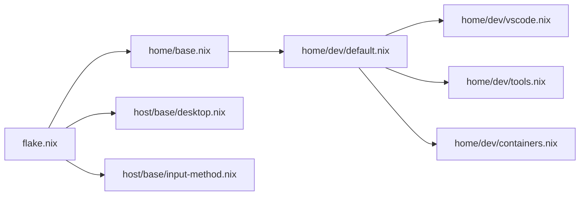
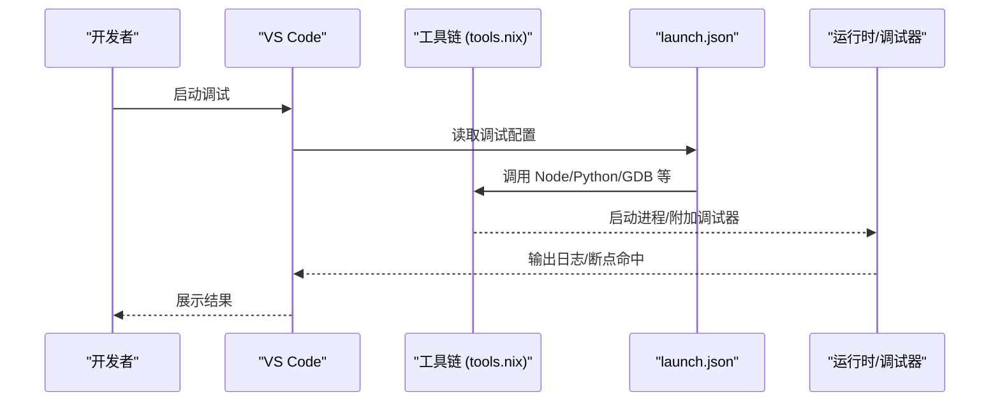

# VS Code 集成

本机 VS Code 由 Home Manager 声明式安装，模块见 `home/dev/vscode.nix`，随 `home/dev/default.nix` 一并导入。每次 rebuild 后版本一致、开箱即用，无需手动下载安装。

## 怎么装

`home/dev/vscode.nix` 只安装 VS Code；主题、用户设置、配置档及扩展由应用自行管理。

要点：

- 安装由 Home Manager 统一管理，改动这个模块后 rebuild 即生效。
- 配套的工具链在 `home/dev/tools.nix`（Node.js、Python、GCC、搜索工具等），VS Code 插件生态所需的运行时基本都在这里提供。
- 容器化开发靠 `home/dev/containers.nix` 的 Distrobox 模板，配合 Remote 场景使用。
- KWallet 和字体由 `host/base/desktop.nix` 提供，Fcitx5 输入法由 `host/base/input-method.nix` 提供，保障凭据存储、中文输入与显示。

## 主题配置

仓库不再声明 VS Code 的自动明暗检测或首选主题，也不再生成和分发 Matugen 色板。通过 VS Code 自身设置选择主题即可。停止 Nix 管理本身不会重置用户设置。2026-10-29 已按用户要求单独卸载 `haikalllp.matugen-theme`，清理其色板缓存及壁纸缓存中的 VS Code 产物；其它扩展与当前自选主题保留。

NextKDE 下运行中切换明暗的故障暂不处理；相关上游记录见 [Electron #48736](https://github.com/electron/electron/issues/48736)。

## 组件关系

- Flake 层：`flake.nix` 引入 Home Manager 并注入用户配置。
- Home Manager 层：`home/base.nix` 聚合各功能模块，`home/dev/default.nix` 再引入 vscode / tools / containers。
- 桌面层：`host/base/desktop.nix` 提供 Keyring 和字体，`host/base/input-method.nix` 提供输入法，直接影响 VS Code 的凭据与界面表现。

## 工作区配置怎么管

VS Code 本体由 Nix 管理，但工作区级配置放在项目仓库里、纳入版本控制，跨机器保持一致：

- `.vscode/settings.json` — 编辑器与语言设置
- `.vscode/tasks.json` — 构建 / 测试 / 格式化任务，复用 `tools.nix` 提供的工具路径
- `.vscode/launch.json` — 调试配置，按语言选对应调试器
- `.vscode/extensions.json` — 推荐扩展清单

敏感信息不要提交，用环境变量或 KWallet 存放。

## 调试与任务集成

- 调试器：在 `launch.json` 声明；确保 `home/dev/tools.nix` 已装好对应运行时与调试符号。
- 任务：在 `tasks.json` 定义构建 / 测试 / 格式化，复用工具链路径。
- 终端：结合 `host/base/input-method.nix` 的输入法配置获得一致交互。

## 远程与容器开发

- Remote SSH / Containers：把工作区挂到远程主机或容器。
- 容器内 toolchain 与宿主机保持一致，避免"在我机器上正常"问题；用 `home/dev/containers.nix` 的 Distrobox 模板快速搭目标环境。

## AI 辅助扩展

VS Code 常搭配 AI 辅助扩展（补全、对话）使用。本仓库的 AI CLI 工具集中在 `home/dev/ai.nix`，走统一来源与安全审查流程，见反链的 memory 卡；扩展本身在 VS Code 商店安装，与 Nix 管理的 CLI 工具互不冲突。

Agent Orchestrator 提供主代理派工、开发看板和审查流程，并通过专用桥接使用 Arch DSH，试用方式见 [Agent Orchestrator](agent-orchestrator.md)。

当前 ai.nix 管理的工具：`codex`、`codex-desktop`，以及 Google Antigravity CLI 与 Antigravity 2.0 Agents 桌面端。Antigravity CLI 在终端用 `agy` 启动；Agents 界面在应用菜单选择 Antigravity，或运行 `antigravity`。这两个包来自锁定的 nixpkgs，未安装 `antigravity-ide`。首次使用时按应用提示完成登录。

Codex 桌面端通过 Home Manager 的 XDG 自启动项在登录桌面后启动，复用包自带的 `codex-desktop.desktop`。它不是开机时运行的 CLI 服务；关闭窗口后不会由本配置强制拉起。取消自启动时，从 `home/dev/ai.nix` 的 `xdg.autostart.entries` 删除对应入口，再应用配置。

另外提供以下 AI 工具；除表中标明的本地包和独立 input 外，版本跟随仓库锁定的 nixpkgs。登录与项目授权在首次启动后按各应用提示完成：

| 工具 | 启动命令 | 包来源 |
|------|----------|--------|
| GitHub Copilot CLI | `copilot` | `github-copilot-cli` |
| Kiro 编辑器 | `kiro` | `kiro` |
| Kiro CLI | `kiro-cli` | `kiro-cli` |
| Cursor 编辑器 | `cursor` | `code-cursor` |
| Cursor CLI | `cursor-agent` | `cursor-cli` |
| Grok Build | `grok` | `grok-build` |
| Paseo CLI／服务端 | `paseo`、`paseo-server` | `paseo` |
| Paseo 桌面端 | `paseo-desktop` | `paseo.desktop` |
| Herdr 桌面版 | `herdr-app` | 本地打包官方发布物 0.1.11 |
| Herdr 桌面运行核心 | `herdr-core`、`hc` | 本地打包官方发布物 0.1.16 |
| Herdr 终端工作区 | `herdr` | `herdr` |
| Kiro Crew | `kirocrew` | 本地打包官方发布物 |
| Grok Bot | `grok-bot` | 固定提交的 `numtide/llm-agents.nix` |

Paseo 和 Herdr 可以用于本地目录，无需为项目添加 GitHub remote。配置只安装程序，不注册常驻服务；Paseo 启动后的 daemon 和跨设备连接按应用内流程管理。Herdr 可在项目目录运行 `herdr`；Nix 包装的代理可能遇到[状态识别问题](https://github.com/herdrdev/herdr/issues/803)，应分别确认终端内代理运行和侧栏状态。

Herdr 桌面版从应用菜单的 **Herdr** 或 `herdr-app` 启动，使用独立的 `herdr-core`，与原有 `herdr` 终端版并存。桌面版和核心由 Nix 更新；不运行应用内安装脚本。官方发布版默认开启使用统计，可在 Settings → Privacy 关闭。当前配置提供启动器和运行依赖，真实桌面启动与代理交互需在应用配置后验证。

Kiro Crew 0.11.1 的官方桌面包未内置 CLI；本地包在同一个运行环境内连接 `kiro-cli-unwrapped`，默认设置绝对 `KIROCREW_KIRO_BIN`，避免重复嵌套运行环境。可通过该环境变量显式覆盖 CLI 路径。

Grok Bot 使用 Cursor 账号，官方 Linux 下载同样由 Cursor 域名提供。社区包为规避上游 Electron webview 崩溃添加 `--no-sandbox`，意味着关闭 Electron 的进程沙箱；这不是系统级权限提升。Kiro Crew 与 Grok Bot 的桌面运行及登录需要在应用系统配置后验证。

这些程序由 Nix 更新，不运行上游的自安装脚本。Grok Build 另带 `agent` 别名，建议使用明确的 `grok` 命令。

同一模块还管理 Agent Reach、OpenCLI、mcporter，并启用 yt-dlp 与本机适配的 Agent Reach Skill。
平台访问的首次连接和字幕提取见 [Agent Reach 与 OpenCLI](agent-reach.md)；Exa 暂不配置。

## 故障排查

| 现象 | 排查 |
|------|------|
| 不跟随系统明暗 | 检查自动检测及首选明暗主题，不能将两者都固定为同一个 Matugen 主题；再检查配置档或工作区覆盖 |
| 凭据无法保存 | 确认 `host/base/desktop.nix` 已启用 KWallet，会话变量正确 |
| 中文输入异常 | 检查 Fcitx5 与 Wayland/XWayland 兼容配置 |
| 调试器不可用 | 确认 `tools.nix` 装了对应运行时且 PATH 正确 |
| 容器内行为不一致 | 核对容器镜像与宿主机 toolchain 版本 |

## 相关链接

- [Neovim](nvim.md) — 另一套由 Nix 管理的编辑器环境
- [深色模式与动态配色](../desktop/darkmode.md) — Darkman、Matugen 缓存与应用分发
- [Matugen Theme](https://marketplace.visualstudio.com/items?itemName=haikalllp.matugen-theme) — 扩展说明
- [wiki 首页](../README.md)
- [ai-tools-source](../../memory/cards/ai-tools-source.md) — AI 工具来源与安全审查决策
