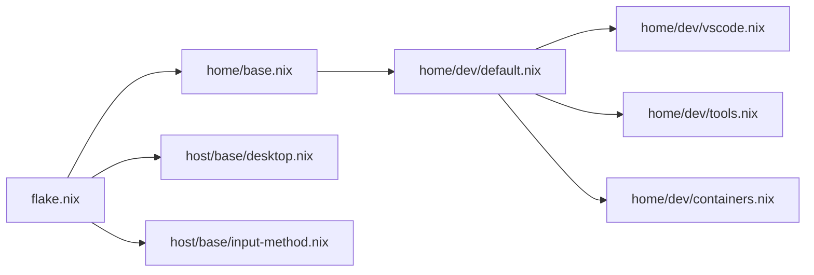
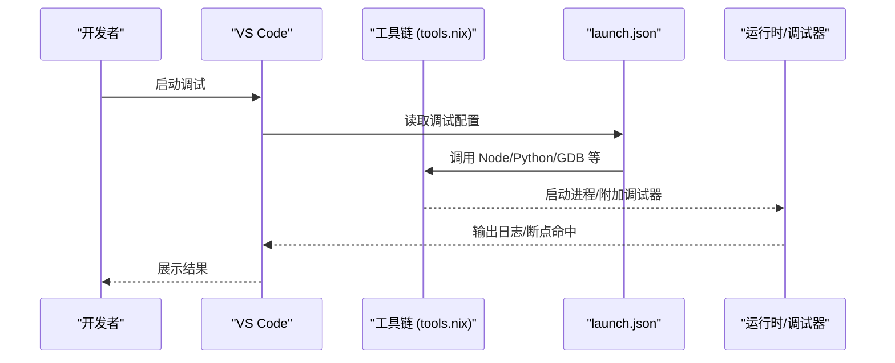

# VS Code 集成

本机 VS Code 由 Home Manager 声明式安装，模块见 `home/dev/vscode.nix`，随 `home/dev/default.nix` 一并导入。每次 rebuild 后版本一致、开箱即用，无需手动下载安装。

## 怎么装

`home/dev/vscode.nix` 只安装 VS Code；主题、用户设置、配置档及扩展由应用自行管理。

要点：

- 安装由 Home Manager 统一管理，改动这个模块后 rebuild 即生效。
- 配套的工具链在 `home/dev/tools.nix`（Node.js、Python、GCC、搜索工具等），VS Code 插件生态所需的运行时基本都在这里提供。
- 容器化开发靠 `home/dev/containers.nix` 的 Distrobox 模板，配合 Remote 场景使用。
- GNOME Keyring 和字体由 `host/base/desktop.nix` 提供，Fcitx5 输入法由 `host/base/input-method.nix` 提供，保障凭据存储、中文输入与显示。

## 主题配置

仓库不再声明 VS Code 的自动明暗检测或首选主题，也不再生成和分发 Matugen 色板。通过 VS Code 自身设置选择主题即可。停止 Nix 管理本身不会重置用户设置。2026-10-29 已按用户要求单独卸载 `haikalllp.matugen-theme`，清理其色板缓存及壁纸缓存中的 VS Code 产物；其它扩展与当前自选主题保留。

NextKDE 下运行中切换明暗的故障暂不处理；相关上游记录见 [Electron #48736](https://github.com/electron/electron/issues/48736)。

## 组件关系

- Flake 层：`flake.nix` 引入 Home Manager 并注入用户配置。
- Home Manager 层：`home/base.nix` 聚合各功能模块，`home/dev/default.nix` 再引入 vscode / tools / containers。
- 桌面层：`host/base/desktop.nix` 提供 Keyring 和字体，`host/base/input-method.nix` 提供输入法，直接影响 VS Code 的凭据与界面表现。

## 工作区配置怎么管

VS Code 本体由 Nix 管理，但工作区级配置放在项目仓库里、纳入版本控制，跨机器保持一致：

- `.vscode/settings.json` — 编辑器与语言设置
- `.vscode/tasks.json` — 构建 / 测试 / 格式化任务，复用 `tools.nix` 提供的工具路径
- `.vscode/launch.json` — 调试配置，按语言选对应调试器
- `.vscode/extensions.json` — 推荐扩展清单

敏感信息不要提交，用环境变量或 GNOME Keyring 存放。

## 调试与任务集成

- 调试器：在 `launch.json` 声明；确保 `home/dev/tools.nix` 已装好对应运行时与调试符号。
- 任务：在 `tasks.json` 定义构建 / 测试 / 格式化，复用工具链路径。
- 终端：结合 `host/base/input-method.nix` 的输入法配置获得一致交互。

## 远程与容器开发

- Remote SSH / Containers：把工作区挂到远程主机或容器。
- 容器内 toolchain 与宿主机保持一致，避免"在我机器上正常"问题；用 `home/dev/containers.nix` 的 Distrobox 模板快速搭目标环境。

## AI 辅助扩展

VS Code 常搭配 AI 辅助扩展（补全、对话）使用。本仓库的 AI CLI 工具集中在 `home/dev/ai.nix`，走统一来源与安全审查流程，见反链的 memory 卡；扩展本身在 VS Code 商店安装，与 Nix 管理的 CLI 工具互不冲突。

Agent Orchestrator 提供主代理派工、开发看板和审查流程，并通过专用桥接使用 Arch DSH，试用方式见 [Agent Orchestrator](agent-orchestrator.md)。

当前 ai.nix 管理的工具：`codex`、`codex-desktop`，以及 Google Antigravity CLI 与 Antigravity 2.0 Agents 桌面端。Antigravity CLI 在终端用 `agy` 启动；Agents 界面在应用菜单选择 Antigravity，或运行 `antigravity`。这两个包来自锁定的 nixpkgs，未安装 `antigravity-ide`。首次使用时按应用提示完成登录。

同一模块还管理 Agent Reach、OpenCLI、mcporter，并启用 yt-dlp 与本机适配的 Agent Reach Skill。
平台访问的首次连接和字幕提取见 [Agent Reach 与 OpenCLI](agent-reach.md)；Exa 暂不配置。

## 故障排查

| 现象 | 排查 |
|------|------|
| 不跟随系统明暗 | 检查自动检测及首选明暗主题，不能将两者都固定为同一个 Matugen 主题；再检查配置档或工作区覆盖 |
| 凭据无法保存 | 确认 `host/base/desktop.nix` 已启用 GNOME Keyring，会话变量正确 |
| 中文输入异常 | 检查 Fcitx5 与 Wayland/XWayland 兼容配置 |
| 调试器不可用 | 确认 `tools.nix` 装了对应运行时且 PATH 正确 |
| 容器内行为不一致 | 核对容器镜像与宿主机 toolchain 版本 |

## 相关链接

- [Neovim](nvim.md) — 另一套由 Nix 管理的编辑器环境
- [深色模式与动态配色](../desktop/darkmode.md) — Darkman、Matugen 缓存与应用分发
- [Matugen Theme](https://marketplace.visualstudio.com/items?itemName=haikalllp.matugen-theme) — 扩展说明
- [wiki 首页](../README.md)
- [ai-tools-source](../../memory/cards/ai-tools-source.md) — AI 工具来源与安全审查决策
