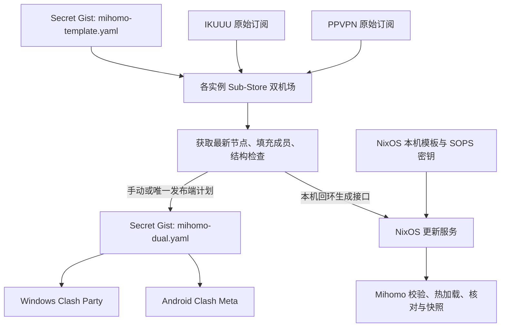

# Mihomo 配置修改与分发

日常规则与策略组只在 Secret Gist 的 `mihomo-template.yaml` 修改。各实例的 Sub-Store 读取同一模板和两家最新节点生成成品；本机 NixOS 直接消费本机生成结果，订阅 Gist 的 Windows 和 Android 客户端消费已发布的 `mihomo-dual.yaml`。本机更新触发生成但不上传；Gist 发布与其他客户端刷新仍是两步。

## 哪一份负责什么

| 位置 | 内容与维护入口 |
| --- | --- |
| Secret Gist：`mihomo-template.yaml` | 人工维护的共同规则、策略组及生成指令；保留注释和分段，节点数组保留 `proxies: []` |
| Sub-Store 原始订阅：`IKUUU`、`PPVPN` | 两家机场订阅地址；URL 变化时在这里修改，不写入模板或仓库 |
| Sub-Store 文件：「双机场」（`dual-provider-mihomo`） | 唯一正式 Mihomo 配置，远程来源读取上述模板，脚本操作 `main(config)` 负责获取节点和填充组成员 |
| Sub-Store 同步：`mihomo-dual.yaml` | 生成并上传 Gist 成品；本机保留手动发布，订阅 Gist 的客户端使用不固定 revision 的 raw HTTPS 地址 |
| NixOS：`host/mihomo-config.yaml.in` | 本机 TUN、DNS、嗅探、端口等设备设置；与共享配置合成 |
| NixOS：`host/base/mihomo.nix`、`host/mihomo-config-sync.py` | 服务和更新逻辑；修改这些实现后需要正常 rebuild |
| NixOS：`host/base/sub-store.nix` | 本机 Sub-Store 服务；恢复数据后可手动发布，也可作为自动发布端 |
| 设备本地策略选择 | 具体节点选择各设备分别保存，不作为共享模板的当前选择上传 |

模板与成品分开，发布任务只写成品。不要编辑成品里的节点或规则：下一次生成会替换它。Sub-Store 中的 `content` 保存模板备份快照，远程来源且关闭合并时不参与生成。

## 分发流程



Windows Clash Party 内置 Sub-Store 当前已经在使用。NixOS 的独立本机实例已恢复数据；本机更新器直接请求它生成配置，Gist 发布和加密备份保留手动运行。每台机器运行自己的实例，并在本机浏览器打开本机服务。

各实例可以使用同一份 Gist 模板和同一个成品地址，但实例数据彼此独立。每次生成时可读取 Gist 上最新模板；订阅 URL、生成脚本和同步任务/Token 存在各实例自己的状态中。修改共享模板不会自动更新其他实例里的脚本或任务，恢复/同步数据时应确认旧实例不会用旧生成逻辑覆盖新成品。建议只选一台启用自动发布和加密备份，其余实例保留手动发布。任一在线实例手动发布后，再让客户端刷新即可；离线期间客户端仍可取到最后一次成品。

本机 Sub-Store 的打开、恢复、手动发布和停止方式见[本机 Sub-Store](sub-store.md)。

## 修改规则或策略组

1. 在自己的 Gist 打开并编辑 `mihomo-template.yaml`，保存。模板入口可从 Sub-Store「文件 → 双机场」的远程 URL 找到；本机受限目录另有 `template-edit-url.txt`。
2. 按规则顺序修改 `rules`、`rule-providers` 或 `proxy-groups`。下载域名特例放在通用 GitHub、Google 等大类前面；规则按顺序匹配。
3. 组名更改时同步修改规则目标和其他组的引用。自动填节点的组保留 `x-sub-store-source`；需要节点优先排列时使用 `x-sub-store-nodes-first`。这些是生成器指令，成品中会移除。
4. 本机 NixOS 运行下文更新服务，或等六小时更新任务；它请求本机 Sub-Store 生成并应用，无需先发布。确认组成员和实际节点选择。
5. 要分发给订阅 Gist 的客户端，到 Sub-Store「同步」执行 `mihomo-dual.yaml`，或等唯一自动发布端的计划，确认成功后再刷新这些客户端。

Sub-Store 关闭「合并来源」、关闭缓存，远程文件失败时报错；它会读取最新远程模板，不将备份快照作为网络失败时的发布后备。「远程优先」只是来源排列方式，不是保护 Gist 的开关，不能用它代替模板与成品分离。

生成器保留节点原名，根据订阅来源填成员，检查两家来源非空、住宅/机房分类、重名、组引用、循环与规则目标。其结构检查不等于每次运行真实 Mihomo 内核检查；新增协议、复杂规则或大改配置后，还要确认目标客户端接受并实际加载。

成品经过 YAML 解析和重新输出，通常不保留模板注释、锚点写法或手工空行；注释模板本身不会被发布任务改写。工作区中旧模板副本不是维护入口，不要用它覆盖 Gist 上后续修改。

## 更新节点与分流约定

机场只是增删节点时不必改模板：每次生成会重新获取两家订阅。机场 URL 变化时编辑对应原始订阅，再刷新本机或发布 Gist 成品；修改 `IKUUU` 或 `PPVPN` 这两个内部订阅名称时，必须同步调整生成脚本的来源名称。

当前分类约定是：AI/Dev 只提供 PPVPN；GitHub 默认住宅；大流量只列 IKUUU；地区只保留美国，PPVPN 只保留住宅与机房分类。原名中的住宅/机房标记用于分类，分类不明确时停止生成，不静默改走另一家。策略组数量由共享模板决定，不是核心固定限制。

大流量是域名分类，不是按速度或累计流量自动检测。同域 HTTPS 网页、Git clone 与大文件可能无法分开；下载特例覆盖容器、包、模型、Nix 缓存和若干发行版域名，但第三方镜像与重定向域名仍需按实际连接补充。MetaCubeX 社区规则集由各端 Mihomo 按 `rule-providers` 的 24 小时间隔更新，与六小时成品发布独立。

## 各端如何接收

| 客户端 | 日常更新 | 立即更新 |
| --- | --- | --- |
| Windows Clash Party | 「双机场」使用 Gist 成品 URL，自动更新设为 360 分钟 | 点该订阅的更新；新导入或直接改持久化元数据后重开客户端以登记计划 |
| Android Clash Meta | 配置 → `+` → 从 URL 导入同一成品，名称「双机场」，更新间隔 6 小时 | 手动更新并选中配置；AnyTLS 节点要求内核支持该协议 |
| NixOS | `mihomo-config-update.timer` 请求本机 Sub-Store 生成，校验后热加载 | 运行下面的更新服务命令，不必先上传 Gist |

```bash
sudo systemctl start mihomo-config-update.service
systemctl status mihomo.service mihomo-config-update.service mihomo-config-update.timer
journalctl -u mihomo-config-update.service -n 30 --no-pager
```

订阅 Gist 的客户端取成品 `mihomo-dual.yaml` 的 raw 链接，不能使用模板链接、GitHub 编辑页或另一台电脑的 `127.0.0.1` 地址。本机更新器则直连自己的 `127.0.0.1:3001/backend/api/file/dual-provider-mihomo?noCache=true`。不要将固定 revision 的 raw 地址用于长期更新。Secret Gist 是持链接可读的分发方式；原始订阅 URL、写入 Token、age 私钥和明文完整配置不提交到本仓库。

## NixOS 服务与配置文件

| 单元 / 文件 | 职责 |
| --- | --- |
| `mihomo.service` | 常驻核心；系统级单元，通过动态用户 `mihomo` 和网络能力运行 TUN |
| `mihomo-config-seed.service` | 核心启动前，使用最后有效共享快照或 SOPS bootstrap；合成并校验启动配置后退出，不联网获取 |
| `mihomo-config-update.service` | 请求本机 Sub-Store 生成，仅取 `proxies`、`proxy-groups`、`rule-providers`、`rules`；合成本机模板及控制密钥，内核校验、热加载并核对成员，成功后更新快照 |
| `mihomo-config-update.timer` | 开机后 15 分钟首次触发，随后按距上次启动更新任务 6 小时触发；不为更新唤醒休眠笔记本 |
| `host/base/mihomo.nix` | 上述单元的声明、依赖和命令参数；配置交付沿用 NixOS 原生 Mihomo 模块 |
| `host/mihomo-config-sync.py` | 同一 Python 程序的 `seed` / `update` 模式；校验不依赖组名或节点前缀 |
| `host/base/sops.nix`、`.sops.yaml` | SOPS 机密来源、接收者规则及 root-only 权限 |
| `host/secrets/mihomo-gist.yaml` | 沿用密文内的 bootstrap，沿用 SSH host key 作为解密依据；旧 Gist URL 不部署 |
| `/var/lib/mihomo-config/` | systemd 管理的 root 私有运行状态；`shared-lastgood.yaml` 是共享快照，`active.yaml` 是合成本机设置后的完整配置 |
| `/var/lib/sub-store/` | systemd 管理的 Sub-Store 私有数据库；包含订阅、脚本及发布/备份设置 |

seed 与 update 都是 root 执行的 oneshot，平时没有更新脚本常驻；Mihomo 核心不以 root 常驻。系统级管理用于全机 TUN、登录前代理和系统级 SOPS；核心通过 systemd credential 接收有效配置，不直接读取原始 SOPS 文件。设计取舍见文末决策卡。

新单元使用 `mihomo-config-*`。只有 update 请求 Sub-Store；seed 只读快照/bootstrap，避免启动时等待需要代理联网的生成服务。本机已完成旧状态迁移并移除兼容逻辑；新机器应恢复 Sub-Store 加密备份，并用 bootstrap 引导。本机更新失败保留旧配置。Gist 模板管策略组与规则，Sub-Store 管机场来源和生成，NixOS 管本机网络设置；rebuild 不重写 Sub-Store 数据库。

日常规则、策略组与节点更新不需要 rebuild。修改本机 TUN/DNS、服务或更新脚本时，编辑仓库源文件，完成验证后由用户正常应用：

```bash
cd ~/myNixOSConfig
sudo nixos-rebuild switch --flake path:.#MechRevo-NixOS
sudo systemctl start mihomo-config-update.service
```

不需要额外安装辅助脚本，也不要手改 `/etc/systemd/system/`、`/nix/store/` 或运行快照。每次 rebuild 不保证立即重新生成；需立即使用模板修改时执行 update。生成时跳过本地模板与订阅缓存，远程失败时保留有效配置，不使用备份 `content` 冒充最新模板。bootstrap 只用于引导，不随定时更新自动写回 SOPS。

## 加密备份与换机

Sub-Store 的 `substore-full-backup` 在本机手动运行；唯一自动发布端可保留每 6 小时、成品发布后 15 分钟的计划。其 `upload=false`，由备份脚本调用原生 age 备份接口写入独立 Secret Gist。备份前读取最新模板，存入同一配置的 `content`，因此备份包含注释模板快照、来源 URL、原始订阅、生成脚本、同步计划与设置。模板、Token 或 age 配置缺失时备份报错，不降级为明文。

恢复材料在发布端的 `Documents/Sub-Store-Recovery/`：`sub-store-age-key.txt`、`sub-store-backup.age`、`restore-info.json` 和恢复说明。私钥必须另存密码管理器或离线介质；本地密文副本不是每次定时同步都会更新。Secret Gist 完整成品包含节点凭据，Sub-Store 管理数据则使用 age 加密，两者用途不同。

1. 准备该备份专用的 Gist Token 和 age 私钥；下载加密备份时保留当前 Token。备份包含两家订阅、双机场文件、模板与成品地址、生成脚本和同步任务。
2. 后端重启会登记备份内的计划；修改单个任务也可能刷新全部计划，因此不要在恢复后逐项删除 cron 来停用自动任务。
3. 选择一种计划处理方式：
   - **多机手动发布：**先导出备份副本，在副本中清除所有同步任务的 cron，再将副本恢复到各实例；保留手动同步。
   - **转移唯一自动发布端：**先停用旧端自动计划，再将备份恢复到新端，并只在新端启用自动发布和备份计划。
4. 恢复后核对订阅、模板地址、成品地址、脚本和计划，再手动发布成品并让客户端刷新。若模板 Gist 丢失，从恢复数据的 `content` 取回模板快照并保存至新的 Secret Gist。NixOS 迁移还需按 SOPS 文档保留解密依据或重新授权新接收者。

## 故障排查与回退

| 现象 | 检查与处理 |
| --- | --- |
| Gist 模板改了，客户端没变 | 本机先检查 update 是否成功生成并应用；订阅 Gist 的其他客户端还需确认成品已发布。检查固定 revision、模板缓存与上游传播延迟 |
| 新节点没出现 | 核对原始订阅地址、内部名称、PPVPN 分类标记及任务错误；不要直接编辑成品节点 |
| 发布失败 | 两家来源或结构检查失败时保留旧成品；修复模板或来源后重新同步 |
| NixOS 更新失败 | 看 update 日志；下载/校验失败保留旧快照，加载验证失败尝试回滚；控制端不可达时不能保证在线回滚成功 |
| 想撤回规则修改 | 从 Gist 历史找回旧模板内容，保存到当前模板，再同步成品、刷新客户端；不要把客户端长期订阅固定到历史 revision |
| 启动时外网不可用 | seed 使用本地最后有效共享快照或 SOPS bootstrap；两者都缺失时先恢复快照/bootstrap，不在启动阶段下载 Gist 成品 |

## 相关链接

- [Mihomo 代理与本机排障](mihomo.md)
- [本机 Sub-Store](sub-store.md)
- [SOPS 机密管理](../security/sops.md)
- [模板与成品分离决策](../../memory/cards/mihomo-template-distribution.md)（本机决策库，不进 Git）
- [Wiki 首页](../README.md)
