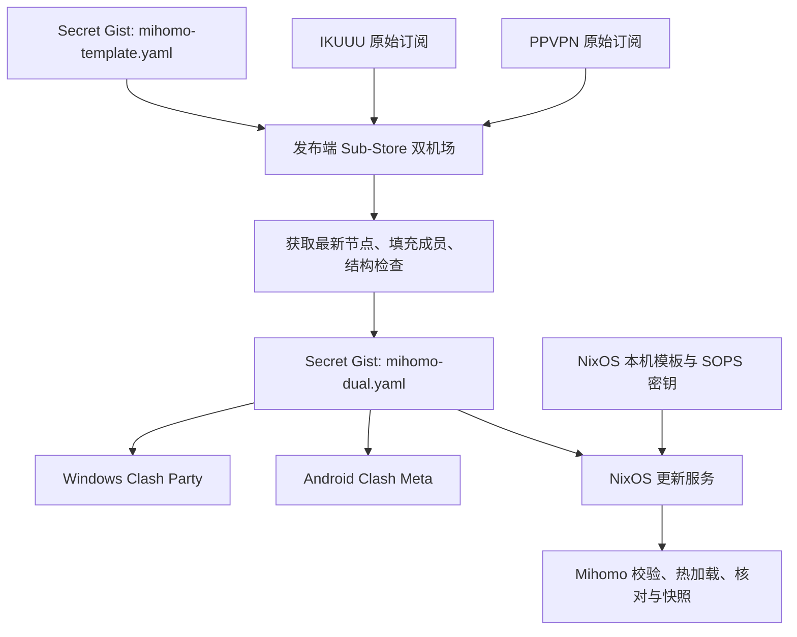

# Mihomo 配置修改与分发

日常规则与策略组只在 Secret Gist 的 `mihomo-template.yaml` 修改。Sub-Store 读取模板和两家最新节点，生成 `mihomo-dual.yaml`；Windows、NixOS 和 Android 订阅成品。发布与客户端下载是两步，点击客户端更新不会触发 Sub-Store 重新发布。

## 哪一份负责什么

| 位置 | 内容与维护入口 |
| --- | --- |
| Secret Gist：`mihomo-template.yaml` | 人工维护的共同规则、策略组及生成指令；保留注释和分段，节点数组保留 `proxies: []` |
| Sub-Store 原始订阅：`IKUUU`、`PPVPN` | 两家机场订阅地址；URL 变化时在这里修改，不写入模板或仓库 |
| Sub-Store 文件：「双机场」（`dual-provider-mihomo`） | 唯一正式 Mihomo 配置，远程来源读取上述模板，脚本操作 `main(config)` 负责获取节点和填充组成员 |
| Sub-Store 同步：`mihomo-dual.yaml` | 自动生成并上传成品，客户端使用其不固定 revision 的 raw HTTPS 地址 |
| NixOS：`host/mihomo-config.yaml.in` | 本机 TUN、DNS、嗅探、端口等设备设置；与共享配置合成 |
| NixOS：`host/base/network.nix`、`host/mihomo-gist-sync.py` | 服务和更新逻辑；修改这些实现后需要正常 rebuild |
| 设备本地策略选择 | 具体节点选择各设备分别保存，不作为共享模板的当前选择上传 |

模板与成品分开，发布任务只写成品。不要编辑成品里的节点或规则：下一次生成会替换它。Sub-Store 中的 `content` 保存模板备份快照，远程来源且关闭合并时不参与生成。

## 分发流程



发布端当前为 Windows Clash Party 内置 Sub-Store，需保持运行；离线时其他设备仍可下载最后一次发布的成品。全量备份与单任务计划保存在 Sub-Store 数据中，不依赖原机器的目录、端口或 Windows 计划任务。NixOS 是成品使用端，不需要安装 Sub-Store。

## 修改规则或策略组

1. 在自己的 Gist 打开并编辑 `mihomo-template.yaml`，保存。模板入口可从 Sub-Store「文件 → 双机场」的远程 URL 找到；本机受限目录另有 `template-edit-url.txt`。
2. 按规则顺序修改 `rules`、`rule-providers` 或 `proxy-groups`。下载域名特例放在通用 GitHub、Google 等大类前面；规则按顺序匹配。
3. 组名更改时同步修改规则目标和其他组的引用。自动填节点的组保留 `x-sub-store-source`；需要节点优先排列时使用 `x-sub-store-nodes-first`。这些是生成器指令，成品中会移除。
4. 到 Sub-Store「同步」执行 `mihomo-dual.yaml`，或等下一次六小时计划。查看任务是否成功、成品是否更新。
5. 在需要立即生效的客户端刷新订阅；NixOS 可手动触发更新服务。确认组成员和 AI/Dev、GitHub 的住宅节点选择。

Sub-Store 关闭「合并来源」、关闭缓存，远程文件失败时报错；它会读取最新远程模板，不将备份快照作为网络失败时的发布后备。「远程优先」只是来源排列方式，不是保护 Gist 的开关，不能用它代替模板与成品分离。

生成器保留节点原名，根据订阅来源填成员，检查两家来源非空、住宅/机房分类、重名、组引用、循环与规则目标。其结构检查不等于每次运行真实 Mihomo 内核检查；新增协议、复杂规则或大改配置后，还要确认目标客户端接受并实际加载。

成品经过 YAML 解析和重新输出，通常不保留模板注释、锚点写法或手工空行；注释模板本身不会被发布任务改写。工作区中旧模板副本不是维护入口，不要用它覆盖 Gist 上后续修改。

## 更新节点与分流约定

机场只是增删节点时不必改模板：每次生成会重新获取两家订阅。机场 URL 变化时编辑对应原始订阅，再同步成品；修改 `IKUUU` 或 `PPVPN` 这两个内部订阅名称时，必须同步调整生成脚本的来源名称。

当前分类约定是：AI/Dev 只提供 PPVPN；GitHub 默认住宅；大流量只列 IKUUU；地区只保留美国，PPVPN 只保留住宅与机房分类。原名中的住宅/机房标记用于分类，分类不明确时停止生成，不静默改走另一家。模板修改可改变组数，当前 17 组不是核心固定限制。

大流量是域名分类，不是按速度或累计流量自动检测。同域 HTTPS 网页、Git clone 与大文件可能无法分开；下载特例覆盖容器、包、模型、Nix 缓存和若干发行版域名，但第三方镜像与重定向域名仍需按实际连接补充。MetaCubeX 社区规则集由各端 Mihomo 按 `rule-providers` 的 24 小时间隔更新，与六小时成品发布独立。

## 各端如何接收

| 客户端 | 日常更新 | 立即更新 |
| --- | --- | --- |
| Windows Clash Party | 「双机场」使用 Gist 成品 URL，自动更新设为 360 分钟 | 点该订阅的更新；新导入或直接改持久化元数据后重开客户端以登记计划 |
| Android Clash Meta | 配置 → `+` → 从 URL 导入同一成品，名称「双机场」，更新间隔 6 小时 | 手动更新并选中配置；AnyTLS 节点要求内核支持该协议 |
| NixOS | `mihomo-gist-update.timer` 触发下载和热加载 | 运行下面的更新服务命令 |

```bash
sudo systemctl start mihomo-gist-update.service
systemctl status mihomo.service mihomo-gist-update.service mihomo-gist-update.timer
journalctl -u mihomo-gist-update.service -n 30 --no-pager
```

订阅地址取成品 `mihomo-dual.yaml` 的 raw 链接，不能使用模板链接、GitHub 编辑页或某台电脑的 `127.0.0.1` 地址。不要将固定 revision 的 raw 地址用于长期更新。Secret Gist 是持链接可读的分发方式；原始订阅 URL、写入 Token、age 私钥和明文完整配置不提交到本仓库。

## NixOS 服务与配置文件

| 单元 / 文件 | 职责 |
| --- | --- |
| `mihomo.service` | 常驻核心；系统级单元，通过动态用户 `mihomo` 和网络能力运行 TUN |
| `mihomo-gist-seed.service` | 核心启动前，优先用最后有效共享快照，其次 SOPS bootstrap，必要时从 Gist 获取；合成并校验启动配置后退出 |
| `mihomo-gist-update.service` | 下载成品，仅取 `proxies`、`proxy-groups`、`rule-providers`、`rules`；合成本机模板及控制密钥，内核校验、热加载并核对成员，成功后更新快照 |
| `mihomo-gist-update.timer` | 开机后 15 分钟首次触发，随后按距上次启动更新任务 6 小时触发；不为更新唤醒休眠笔记本 |
| `host/base/network.nix` | 上述单元的声明、依赖、命令参数与 systemd credential 交付 |
| `host/mihomo-gist-sync.py` | 同一 Python 程序的 `seed` / `update` 模式；校验不依赖组名或节点前缀 |
| `host/base/sops.nix`、`.sops.yaml` | SOPS 机密来源、接收者规则及 root-only 权限 |
| `host/secrets/mihomo-gist.yaml` | 加密的 Gist URL 与 bootstrap，沿用 SSH host key 作为解密依据 |
| `/persist/secrets/mihomo-gist-state/` | root 私有运行状态；`shared-lastgood.yaml` 是共享快照，`active.yaml` 是合成本机设置后的完整配置 |

seed 与 update 都是 root 执行的 oneshot，平时没有更新脚本常驻；Mihomo 核心不以 root 常驻。系统级管理用于全机 TUN、登录前代理和系统级 SOPS；核心通过 systemd credential 接收有效配置，不直接读取原始 SOPS 文件。设计取舍见文末决策卡。

日常规则、策略组与节点更新不需要 rebuild。修改本机 TUN/DNS、服务或更新脚本时，编辑仓库源文件，完成验证后由用户正常应用：

```bash
cd ~/myNixOSConfig
sudo nixos-rebuild switch --flake path:.#MechRevo-NixOS
sudo systemctl start mihomo-gist-update.service
```

不需要额外安装辅助脚本，也不要手改 `/etc/systemd/system/`、`/nix/store/` 或运行快照。每次 rebuild 不保证立即拉取最新 Gist；需立即拉取时执行 update。bootstrap 只用于引导，不随定时更新自动写回 SOPS。

## 加密备份与换机

Sub-Store 的 `substore-full-backup` 每 6 小时运行，计划在成品发布的 15 分钟后；其 `upload=false`，由备份脚本调用原生 age 备份接口写入独立 Secret Gist。备份前读取最新模板，存入同一配置的 `content`，因此备份包含注释模板快照、来源 URL、原始订阅、生成脚本、同步计划与设置。模板、Token 或 age 配置缺失时备份报错，不降级为明文。

恢复材料在发布端的 `Documents/Sub-Store-Recovery/`：`sub-store-age-key.txt`、`sub-store-backup.age`、`restore-info.json` 和恢复说明。私钥必须另存密码管理器或离线介质；本地密文副本不是每次定时同步都会更新。Secret Gist 完整成品包含节点凭据，Sub-Store 管理数据则使用 age 加密，两者用途不同。

1. 新机器安装支持 age 备份与单任务计划的 Sub-Store Node 后端，填写同账号的专用 Gist Token 和已保存的 age 私钥，恢复 Token 策略选「保留」。
2. 从 Gist 下载恢复全量数据，重启后端以登记计划；核对两家订阅、唯一「双机场」、成品发布和加密备份任务。
3. 检查远程模板 URL，手动执行一次成品同步和加密备份，再让各客户端刷新；保留成品地址时无需重新分发。
4. 若模板 Gist 丢失，从恢复配置的 `content` 取回模板快照，保存到新的 Secret Gist，再修改远程模板 URL；不要开启合并。
5. 交接后只保留一台发布端启用计划，避免旧机器覆盖成品。NixOS 迁移还需按 SOPS 文档保留解密依据或重新授权新接收者。

## 故障排查与回退

| 现象 | 检查与处理 |
| --- | --- |
| Gist 模板改了，客户端没变 | 先确认 Sub-Store 发布成功，再确认客户端刷新；发布端离线、模板缓存、固定 revision URL 都可能使版本停留 |
| 新节点没出现 | 核对原始订阅地址、内部名称、PPVPN 分类标记及任务错误；不要直接编辑成品节点 |
| 发布失败 | 两家来源或结构检查失败时保留旧成品；修复模板或来源后重新同步 |
| NixOS 更新失败 | 看 update 日志；下载/校验失败保留旧快照，加载验证失败尝试回滚；控制端不可达时不能保证在线回滚成功 |
| 想撤回规则修改 | 从 Gist 历史找回旧模板内容，保存到当前模板，再同步成品、刷新客户端；不要把客户端长期订阅固定到历史 revision |
| 启动时外网不可用 | 正常情况下 seed 使用本地最后有效共享快照或 SOPS bootstrap；首次无任何可用副本才依赖远程 |

## 相关链接

- [Mihomo 代理与本机排障](mihomo.md)
- [SOPS 机密管理](../security/sops.md)
- [模板与成品分离决策](../../memory/cards/mihomo-template-distribution.md)（本机决策库，不进 Git）
- [Wiki 首页](../README.md)
