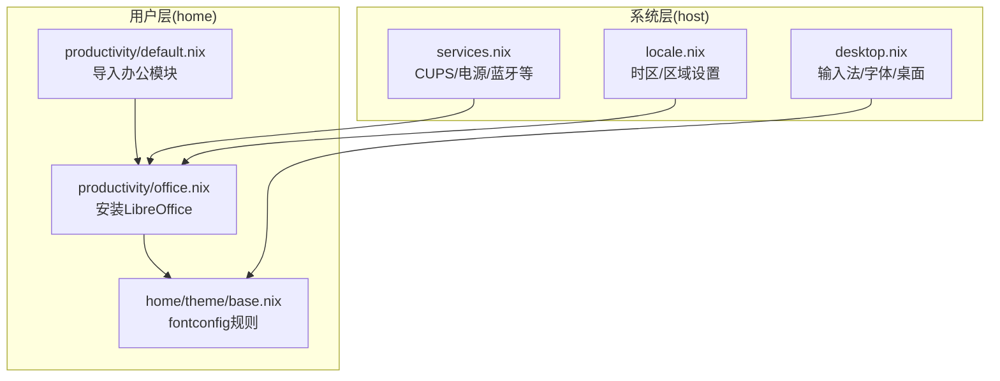
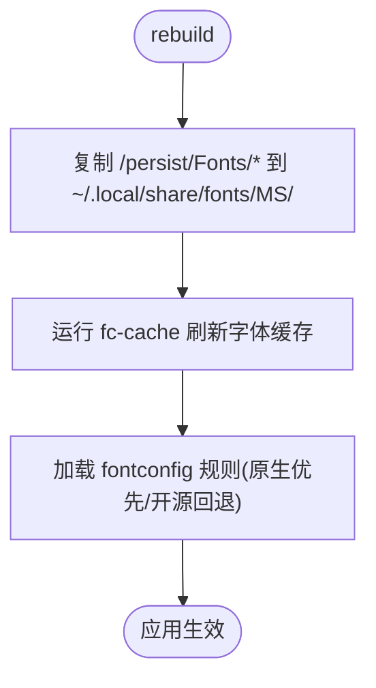

# 办公软件套件

办公应用由用户层模块 `home/productivity/office.nix` 安装，配合系统层的字体、输入法、打印服务，构成完整的中文办公环境。本文说明装了什么、CJK 字体怎么落地、以及打印 / PDF 导出与协作的用法。

## 装了什么

`home/productivity/office.nix` 通过 `home.packages` 安装：

- **LibreOffice Stable** — 文档 / 表格 / 演示，全能主力
- **笔记 / Markdown**：Obsidian、Typora、Zettlr、Ghostwriter
- **文献管理**：Zotero（Nixpkgs 包 `zotero`）
- **AI 文档工作区**：Agentero（`local-deriv` 重打包的上游发布包，见下文）

办公套件保留 LibreOffice；默认打开方式可在桌面的文件关联设置中选择。

## Zotero 文献管理

手动应用配置后，在应用启动器搜索 **Zotero**，或在终端运行：

```bash
zotero
```

两个桌面变体共用此应用。当前锁定版本为 Zotero 10.0.4；其 Mozilla 运行时 Firefox ESR 140 已停止安全维护，Nixpkgs 默认拒绝评估。经用户选择，`host/base/nix.nix` 仅放行确切版本 `firefox-esr-140-bin-unwrapped-140.17.0esr`。更新 Nixpkgs 后若引擎已升级，应移除此例外；若仍因其他版本报错，重新核对依赖，不扩大全局放行范围。

## Agentero

Agentero 是面向文档与代理的 AI 工作区。它从上游 v0.15.4 的 amd64 deb 重打包，经 `home/productivity/office.nix` 装到两个桌面变体。应用启动器搜索 **Agentero**，或运行 `agentero`。

包装方式与构建入口：

- `local-deriv/agentero.nix` 校验上游 release 包哈希后重打包（MIT），并在 flake 暴露 `packages.x86_64-linux.agentero`。
- 独立构建检查：`nix build path:.#agentero --no-link -L`。
- 选择二进制路线而非源码构建：上游源码构建期有多个 `build.rs` 需要联网下载，难以复现；deb 内已包含 plugin host、ACP adapters 与 PDFium，重打包更可控。
- 许可证与第三方 notices 固定到 release commit `fdacc2bc` 的原文，安装到 `share/licenses/agentero/`。

运行时：

- wrapper 以 `--prefix PATH` 追加 Node（≥22）、git、openssh、xdg-utils，不覆盖你自己的 PATH；应用仍会优先使用你环境中的 Claude/Codex。
- 运行库由 nixpkgs 提供（GTK3、WebKitGTK 4.1、libsoup3、glib-networking 等），不需要系统级另装。
- `PDFIUM_LIB_PATH` 与 `AGENTERO_PLUGIN_WORKER` 指向包内 PDFium 与插件 sidecar。
- 不需要本地 Python；OCR 的 traineddata 可能首次使用时联网获取，离线环境可预置语言数据并设 `TESSDATA_PREFIX`。
- 不随包提供 TeX Live；需要 LaTeX 排版时自行补进环境，不要假定可用。

使用边界：

- 没有独立 CLI 包。应用内“Install CLI”生成的命令同样叫 `agentero`，会与桌面入口冲突；不要把它当作 Nix 安装的替代。
- 自更新不适用：应用启动时仍会联网检查更新，但应用内基于 dpkg 的安装在 Nix 下不可用；升级时更新 derivation 的 `version`、release commit 与各文件哈希。
- 部分 PDF 导出 / 缺失字体回退逻辑硬编码 `/usr/share/fonts` 下的 CJK 字体路径，NixOS 上可能不可用；本包未修改系统目录，也不承诺该功能正常。

## 分层结构

系统层（`host/`）铺基础设施，用户层（`home/`）装应用：



## CJK 字体怎么落地

中文显示是办公场景的关键，字体来自三处：

- **系统开源字体**（`host/base/desktop.nix`）：WQY、Noto CJK、思源宋体/黑体、方正系列、Emoji、多种等宽字体。
- **MS 授权字体**：`office.nix` 里有一段 activation 脚本，每次 rebuild 把 `/persist/Fonts/` 下的 `.ttf`/`.ttc` 复制到 `~/.local/share/fonts/MS/` 并刷新 `fc-cache`，避免首次部署缺字。
- **fontconfig 替换链**（`home/theme/base.nix`）：实现"原生优先、开源回退"，让 Office 中英文混排更自然。



## 输入法与本地化

- **Fcitx5 + Rime**（`host/base/input-method.nix`）：GTK/Qt/X11/Wayland 多环境兼容，Office 中文输入体验一致。
- **区域设置**（`host/locale.nix`）：时区 Asia/Shanghai，语言 zh_CN.UTF-8，数字 / 日期 / 排序符合中文习惯。

## 打印与 PDF 导出

- 系统层 `host/services.nix` 启用 CUPS，为 LibreOffice 提供打印能力。
- LibreOffice 支持"导出为 PDF"，底层依赖系统字体与渲染管线，中文排版正确的前提是字体回退链生效。
- 批量转换用无头模式命令行，例如脚本化 `docx → pdf`：

```bash
libreoffice --headless --convert-to pdf --outdir out/ *.docx
```

## 协作

- OneDrive 已在环境中启用，可做文档云端同步；重要文档放 OneDrive 目录，利用版本历史与共享链接。
- 在线协作平台（腾讯文档、飞书、Google Docs）通过系统浏览器访问，与本地 OneDrive 形成本地-云端工作流。

## 故障排查

| 现象 | 排查 |
|------|------|
| 中文字形缺失 | 确认 `/persist/Fonts/` 有授权字体，rebuild 已复制到 `~/.local/share/fonts/MS/` |
| 打印失败 / PDF 乱码 | 确认 CUPS 已启用、打印机已添加；检查中文字体回退链 |
| Office 内输入法不可用 | 确认 Fcitx5 环境变量已设，GTK/Qt 输入模块启用 |
| 首次部署找不到字体 | 重新 rebuild，让 activation 复制字体并刷新缓存 |
| 找不到 Zotero 或命令不存在 | 确认已手动应用包含 Zotero 的配置，再重新打开应用启动器 |
| 找不到 Agentero 或命令不存在 | 确认已应用包含本次改动的配置；用 `nix build path:.#agentero --no-link -L` 单独检查产物 |
| Agentero 首次 OCR 卡住或失败 | traineddata 可能首次联网获取；离线环境预置语言数据并设 `TESSDATA_PREFIX` |
| Agentero 提示“Install CLI” | 不要点：该 CLI 与应用同名 `agentero`，Nix 安装已提供桌面入口 |
| Agentero 内自更新无效 | Nix 下 dpkg 自更新不适用；升级改 derivation 的版本与哈希后重建 |

## 相关链接

- [wiki 首页](../README.md)
- [约束与惯例](../constraints.md) — 字体包归属 `local-deriv`、模块去重规则
- [Nix 手工打包](../dev/nix-packaging.md) — 本地派生、哈希更新与验证流程
- [fcitx5-vertical-candidates](../../memory/cards/fcitx5-vertical-candidates.md) — Fcitx5 输入法相关决策
