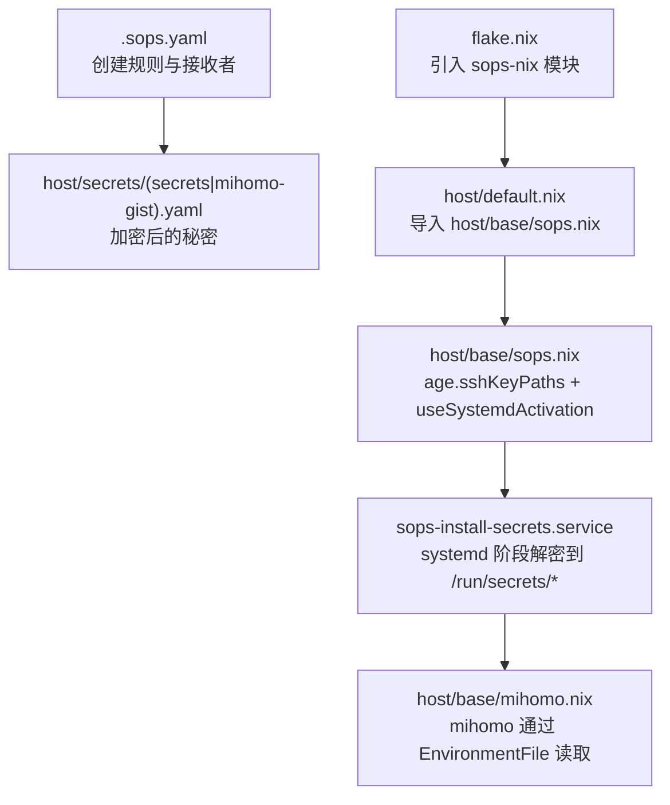
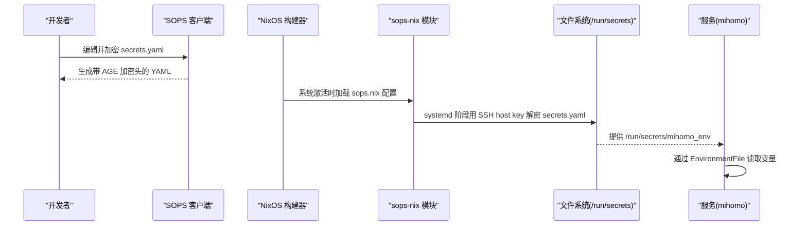
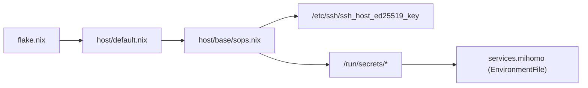

# SOPS 机密管理

本仓库使用 SOPS-Nix + Age 对敏感信息进行加密存储与分发：开发侧用 Age 公钥加密 YAML，系统激活时由 sops-nix 在 systemd 阶段使用解密密钥（SSH host key）解密到 `/run/secrets/` 下的受控文件，服务（如 mihomo）以最小权限读取。实现「配置即代码 + 机密分离」。

> [!note] 2026-08-09 迁移
> 解密密钥已从独立 age key（`/persist/sops-age-key.txt`）切换到 **SSH host key**（`/etc/ssh/ssh_host_ed25519_key`），并启用 `useSystemdActivation`。原因与流程见 [memory 决策卡](../../memory/cards/sops-ssh-host-key.md) 与 [迁移指南](../../../Documents/MyVault/01_Inbox/sops%20迁移指南：SSH%20host%20key%20切换案例.md)。

## 目录
1. [涉及文件](#涉及文件)
2. [工作流程](#工作流程)
3. [配置详解](#配置详解)
4. [新增一项机密](#新增一项机密)
5. [密钥轮换](#密钥轮换)
6. [备份与恢复](#备份与恢复)
7. [故障排查](#故障排查)
8. [相关链接](#相关链接)

## 涉及文件
- `.sops.yaml`：SOPS 客户端配置，定义 Age 接收者（SSH host key 公钥）与创建规则。
- `host/secrets/secrets.yaml`：加密后的秘密清单（密文 + SOPS 元数据）。
- `host/secrets/mihomo-gist.yaml`：沿用现有密文内的 Mihomo bootstrap；旧 Gist URL 保留在密文中，但不再部署到运行时。
- `host/base/sops.nix`：NixOS 模块，声明解密密钥来源（`age.sshKeyPaths`）、`useSystemdActivation`、默认密文文件与机密映射。
- `flake.nix`：引入 sops-nix 的 NixOS 模块。
- `host/default.nix`：导入 `host/base/sops.nix` 使配置生效。
- `host/base/mihomo.nix`：mihomo 服务通过 `EnvironmentFile` 和 SOPS secret 路径消费机密。

## 工作流程
下图展示从开发机编辑加密 YAML，到系统激活的 systemd 阶段解密，再到运行时服务读取的完整流程。

依赖关系：

## 配置详解
**客户端规则（`.sops.yaml`）**：`keys` 声明 Age 公钥（接收者）；`creation_rules` 的 `path_regex` 精确匹配 `host/secrets/(secrets|mihomo-gist)\.yaml$`，将这两个密文文件绑定到该公钥。只有持有对应 Age 私钥的人才能本地解密/重加密。当前接收者为 SSH host key 的 age 公钥。

**秘密清单**：`host/secrets/secrets.yaml` 保留现有顶层项（如 `mihomo_env`）；独立的 `host/secrets/mihomo-gist.yaml` 使用顶层键 `mihomo_gist_url` 与 `mihomo_bootstrap`。值由 SOPS 加密，文件含 age 收件人及完整性元数据。

**NixOS 模块（`host/base/sops.nix`）**：
- `sops.age.sshKeyPaths = ["/etc/ssh/ssh_host_ed25519_key"]` 使用系统 SSH host key 作为解密私钥（免单独管理 age 私钥）。
- `sops.useSystemdActivation = true` 让 secrets 通过 `sops-install-secrets.service` 在 systemd 阶段安装（`after = local-fs.target`），而非 initrd activation script——避免 initrd 阶段读不到已挂载文件系统的时序问题。
- `sops.defaultSopsFile` 指定默认密文文件 `secrets/secrets.yaml`；bootstrap 单独指定 `secrets/mihomo-gist.yaml`。
- `sops.secrets.<name>` 将键映射为 `/run/secrets/<name>` 并设置 owner/group/mode。当前 Mihomo 部署 `mihomo_env` 与 `mihomo_bootstrap`，均为 `root:root`、`0400`；不再安装 `mihomo_gist_url`。

**服务消费（`host/base/mihomo.nix`）**：`mihomo-config-seed` 与 `mihomo-config-update` 通过 `EnvironmentFile` 读取 `mihomo_env`，其中 seed 还可读取 bootstrap，update 只向本机 Sub-Store 获取新成品。Mihomo 主服务通过原生 systemd credential 取得 `/var/lib/mihomo-config/active.yaml`，不直接读取这些 SOPS 文件。secret 安装依赖 `sops-install-secrets.service`；`/run` 为临时目录，重启后会重新解密安装。Sub-Store 数据库与 Mihomo 快照属于受限运行状态，由各自的 systemd `StateDirectory` 管理。

## 新增一项机密
1. 在对应的加密 YAML 中添加新键（用 `sops` 命令编辑）。
2. 用 `sops` 按 `.sops.yaml` 规则重新加密该文件。
3. 在 `host/base/sops.nix` 的 `sops.secrets` 块声明新键，设置 owner/group/mode 和对应密文文件。
4. 在服务配置中通过 `config.sops.secrets.<name>.path` 引用。

## 密钥轮换
- 新增接收者：在 `.sops.yaml` 的 `keys` 添加新 Age 公钥，再用 `sops updatekeys`（需旧 key 权限）同步，使新旧接收者都可解密。
- 移除旧接收者：从 `.sops.yaml` 移除对应 `keys`，再用 `sops updatekeys` 同步，仅保留需要的接收者。
- 每次轮换会更新 MAC 与时间戳，确保完整性校验有效。
- 换 key 的完整流程与踩坑见 [memory 决策卡](../../memory/cards/sops-ssh-host-key.md)。

## 备份与恢复
- 备份：解密密钥 **SSH host key** `/etc/ssh/ssh_host_ed25519_key`（随系统迁移）、`host/secrets/*.yaml` 密文及规则 `.sops.yaml`。
- 恢复：确认 SSH host key 就位，应用系统配置后由 systemd 阶段解密，验证 `/run/secrets/*` 已按预期生成。
- 迁移到新机器：恢复这些密文仍需**沿用原 SSH host key**；若无法沿用，需有权解密的原接收者将新 host key 的 Age 公钥加入 `.sops.yaml` 并重新授权/加密，否则无法恢复。Mihomo bootstrap 不会被每六小时的 Sub-Store 更新自动改写。

## 故障排查
- **激活时找不到解密密钥**：确认 `/etc/ssh/ssh_host_ed25519_key` 存在且权限正确（root 可读）；确认 `.sops.yaml` 接收者与该 key 的 age 公钥匹配。
- **服务启动无环境变量**：确认服务依赖 `sops-install-secrets.service`（`after`/`wants`）；检查 `/run/secrets/<name>` 已生成且权限符合预期；确认 `useSystemdActivation = true`。
- **本地无法编辑 secrets.yaml**：本地安装 `sops`（已在 `home/dev/tools.nix`），解密需 root（key 文件 root 所有），用 `sudo nix shell nixpkgs#sops -c` 包装。
- **initrd 阶段报 setupSecrets 失败**：多为 `/persist` 等 stage-2 挂载点被 sops 依赖——改用 `useSystemdActivation = true` 让解密在 local-fs.target 之后进行。

## 相关链接
- 安全与隐私总览：[index.md](./index.md)
- Mihomo 网络代理（消费 `mihomo_env` 与 bootstrap）：[../networking/mihomo.md](../networking/mihomo.md)
- 决策：mihomo TUN 栈与 `mihomo_env` 机密 → [mihomo-tun-stack](../../memory/cards/mihomo-tun-stack.md)
